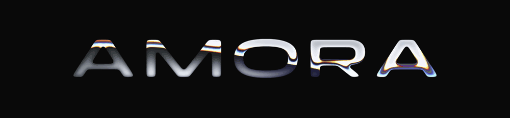

<div align="center">

<picture>
  <source srcset="docs/brand/amora-liquid.webp" type="image/webp" />
  
</picture>

# Amora

**Private AI companions: fourteen written characters, each with a face, a city and a long memory.**

A mobile-first web app (PWA) for adults. Pick a companion, read her card, and let her open the conversation.


</div>

---

> [!IMPORTANT]
> **The front end is complete; the backend is not built yet.** Chat replies are scripted, and payments, accounts and media are simulated in the browser. New team: start with **[docs/HANDOVER.md](docs/HANDOVER.md)**, then **[docs/INTEGRATIONS.md](docs/INTEGRATIONS.md)**.

## Features

| | |
|---|---|
| **Landing** | Age gate, liquid-metal wordmark, companion showcase, chat demo, pricing, FAQ |
| **Board** | Agency-style comp cards with tilt, density control (2–5 columns), save |
| **Discover** | Swipe deck with momentum, keyboard and undo, plus *Online now / New / By vibe* rails |
| **Profiles** | Comp card, "How she says hello", gallery lightbox, "More like her" |
| **Chat** | Realistic pacing (typing, read receipts, one bubble at a time), quick replies, voice notes, gifts, locked photos that "develop" on unlock |
| **Inbox** | Conversations plus *Moments* stories |
| **You** | Premium, coin wallet, 12 achievements, privacy settings, account deletion flow |
| **Design system** | `/system`: tokens, components and a **Demo / Worst case / Empty** data toggle |

Built mobile-first with safe areas, keyboard-aware chat, reduced-motion support and privacy-first cookie consent.

## Quick start

Requires **Node 20.9+** (developed on Node 24) and npm.

```bash
npm install
npm run dev        # http://localhost:3000
```

| Command | What it does |
|---|---|
| `npm run dev` | Dev server (Turbopack) |
| `npm run build` | Production build, including the type check |
| `npm run start` | Serve the production build |
| `npm run lint` | ESLint |

No environment variables are needed today. The planned ones are listed in [`.env.example`](.env.example). There is no test suite yet.

## Tech stack

- **Next.js 16** with App Router and Cache Components. Its APIs differ from older docs; see `node_modules/next/dist/docs/`.
- **React 19** and **TypeScript**.
- **Tailwind CSS 4** with design tokens in `src/app/globals.css`.
- **Motion** for springs and gestures; **Sonner** for toasts.
- **three.js** / shadergradient for the silk background; a WebGL liquid-metal wordmark.
- Fonts: Panchang and Switzer (Fontshare).

## Project structure

```
src/
  app/                 routes: landing, /app (board, discover, chats, saved, me, [id], [id]/chat), login, legal, system
  components/          UI: board/, chat/, discover/, landing/, profile/, liquid-logo/, …
  lib/                 companions, chat scripts, wallet, progress, plans (mock data and state)
public/companions/v2/  companion portraits
docs/                  handover, integration briefs, audit, photo prompt kit
```

## Routes

| Route | Screen |
|---|---|
| `/` | Landing |
| `/app` | Board |
| `/app/discover` | Discover deck |
| `/app/[id]` | Companion profile |
| `/app/[id]/chat` | Chat |
| `/app/chats` | Inbox and stories |
| `/app/saved` | Saved companions |
| `/app/me` | Membership, coins, achievements, account |
| `/login` | Sign up / sign in |
| `/terms`, `/privacy` | Legal (drafts) |
| `/system` | Design system |

## Roadmap

What's simulated today and the plan to make it real. There is one brief per item in **[docs/INTEGRATIONS.md](docs/INTEGRATIONS.md)**, and each plug-in point is marked `HANDOVER:` in the code.

- [ ] **Auth and age verification:** real accounts, protected `/app`.
- [ ] **Persistence:** chats, wallet and progress in a database (EU region).
- [ ] **AI chat:** in-character LLM conversations with long memory, reusing the existing human-like pacing.
- [ ] **Payments:** checkout and a server-side coin ledger (high-risk / crypto processor).
- [ ] **Voice notes:** a real voice per companion (e.g. ElevenLabs).
- [ ] **Personalized photos and video:** on-demand, on-model media (e.g. Higgsfield).
- [ ] **Voice calls:** realtime voice with the same persona.
- [ ] **Launch readiness:** GDPR deletion, security headers, reviewed legal texts, real-device testing.

```bash
grep -rn "HANDOVER:" src    # every integration point
grep -rn "shortcut:" src    # every known simplification
```

## Deployment

Deployed on **Vercel**: every push to `main` deploys to production (currently behind Vercel login). See the transfer checklist in [docs/HANDOVER.md](docs/HANDOVER.md#transfer-checklist-seller--buyer).

## Documentation

| Doc | |
|---|---|
| [docs/HANDOVER.md](docs/HANDOVER.md) | Start here: status, code map, transfer checklist, licenses |
| [docs/INTEGRATIONS.md](docs/INTEGRATIONS.md) | Build briefs: AI chat, auth, DB, payments, voice, video, deletion, calls |
| [DESIGN.md](DESIGN.md) | Visual system: tokens, type, spacing, motion |
| [PRODUCT.md](PRODUCT.md) | Users, purpose, tone |
| [docs/companion-prompts.md](docs/companion-prompts.md) | Prompt kit for consistent companion photos |
| [docs/maintenance/](docs/maintenance/) | Audit and current status |

## Content notice

All companions are **fictional adults (18+)**. Portraits are AI-generated and do not depict real people. The product is intended for adults only.

## License

No open-source license: all rights reserved by the project owner. Third-party code and fonts keep their own licenses (see [HANDOVER.md](docs/HANDOVER.md#transfer-checklist-seller--buyer)).
